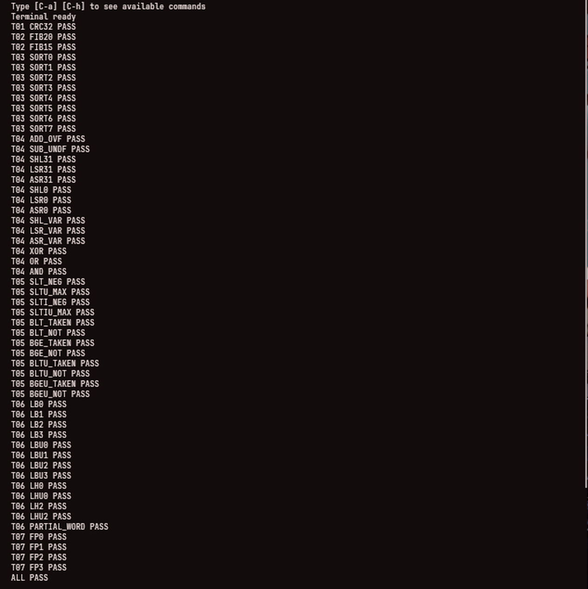
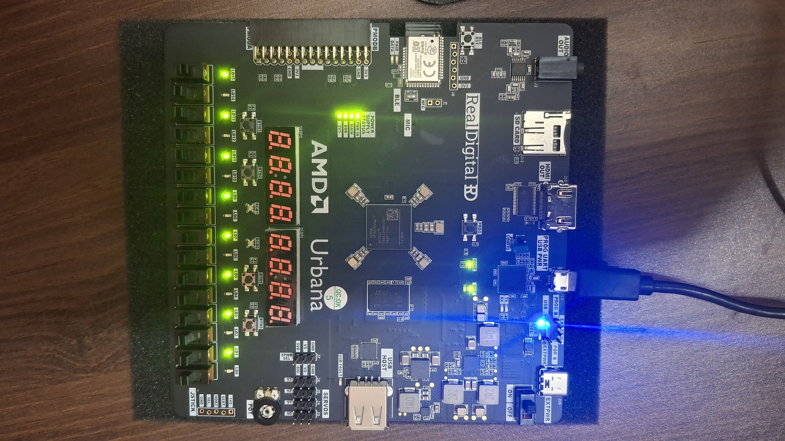
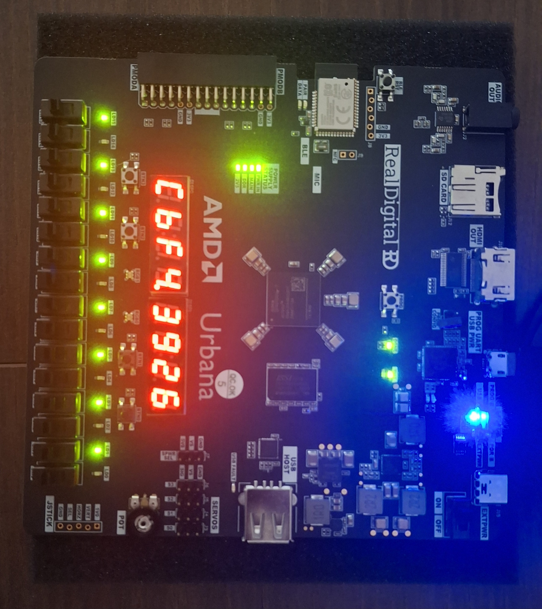
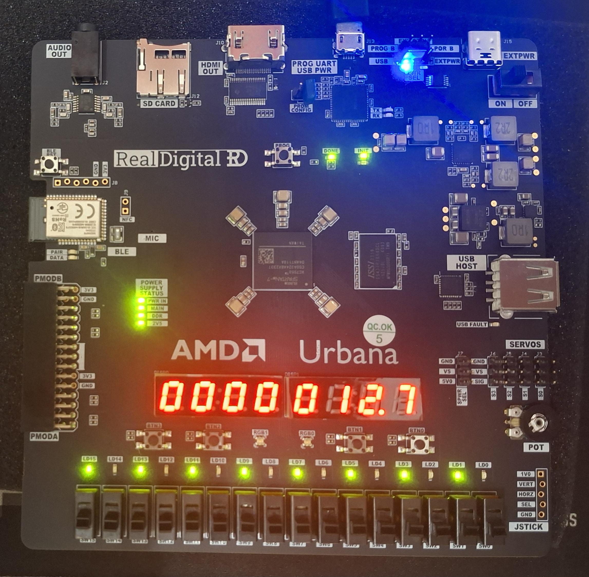

# Urbana implementation of RV32I

RV32I CPU project on the RealDigital Urbana (Spartan-7 XC7S50, speed grade -2), for an MPMC course.

## Status
- Phase 0: SoC around unmodified PicoRV32 (UART + 16 LEDs). Simulation PASS, Vivado timing met at 100 MHz. **Board test: verified on Urbana (UART greeting + LED sweep).**
- Phase 1: own single-cycle RV32I core, in progress (ALU and branch comparator first).

## Phase 0 results (Vivado 2024.2, post-implementation, 100 MHz)
| Metric | Value |
|---|---|
| Slice LUTs | 2060 (6.3%) |
| LUT as Memory | 1068 |
| Slice registers | 615 |
| WNS / WHS | +2.102 ns / +0.101 ns |

Reports are in docs/reports/.

## Memory map
- 0x0000_0000 RAM, 8 KB
- 0x1000_0000 LED register (16 bits)
- 0x1000_0004 UART TX data
- 0x1000_0008 UART status (bit 0 = busy)

## Build
    git clone --recursive https://github.com/aayushimaginator/RISCV.git
    make -C firmware DELAY_N=20
    iverilog -o soc_tb.vvp tb/soc_tb.v rtl/soc_top.v rtl/ram_lutram.v rtl/uart_tx.v third_party/picorv32/picorv32.v
    vvp soc_tb.vvp
    make -C firmware clean && make -C firmware
    vivado -mode batch -source build.tcl

## Tools
Code was generated with LLM assistance (Qwen for generation, Claude for review). All results above come from tools run locally.

## License
MIT for this repo's own code. third_party/picorv32 is ISC (YosysHQ).

## Phase 1: own 2-stage RV32I core (50 MHz)

| Item | Result |
|---|---|
| Clock | 100 MHz pin -> MMCM -> 50 MHz system clock (20 ns) |
| Setup / hold slack | WNS +2.163 ns / WHS +0.090 ns (post-route, Vivado 2024.2) |
| Critical path | 17.6 ns: data-RAM read -> LSU -> forwarding -> branch compare -> next PC |
| Real Fmax | about 56 MHz (not 100 MHz) |
| Verification | 7 unit tests; 50/50 random programs match a Python ISS; SoC sim PASS |
| Board test | superseded by Phase 2 (never run on hardware) |

History: the single-cycle core failed 100 MHz (WNS -7.07 ns). The 2-stage version keeps
branch resolution and forwarding in one stage, so the critical path is not shorter. An
earlier commit claimed 100 MHz from a 20 ns constraint on a 100 MHz pin; that was wrong
and is corrected here with a real MMCM-derived clock.
Code was written with LLM assistance and independently verified.

### Compliance
- riscv-tests rv32ui: 40/40 pass (minimal ECALL-terminated env in `tests/rvtest_env`; `fence_i` and `ma_data` skipped as out of scope). Each result also agrees with the Python ISS.
- CPI on that suite: about 1.07 (short tests, includes pipeline fill).
- Run: `tools/run_riscv_tests.sh`

## Phase 2: 4-stage core (IF | EX | MEM | WB), 75 MHz

| Item | Result |
|---|---|
| Clock | 100 MHz pin -> MMCM -> 75 MHz system clock (13.33 ns) |
| Setup / hold slack | WNS +1.427 ns / WHS +0.048 ns (post-route, Vivado 2024.2) |
| Critical path | 11.9 ns: instruction reg -> decode/immgen -> ALU adder (JALR target) -> next PC |
| Estimated Fmax | about 84 MHz |
| Verification | unit tests; 200/200 random programs vs ISS; riscv-tests rv32ui 40/40; SoC sim PASS |
| CPI | about 1.08 on rv32ui (short tests, includes pipeline fill) |
| Board test | **verified on Urbana**: bitstream at 75 MHz prints `Hello, RV32I!` on UART and runs the LED sweep, about 2.8x faster than the PicoRV32 control on the same firmware |

Change from Phase 1: load data is registered at the end of MEM and forwarded from the WB
register, so the data-RAM read no longer sits in the branch-resolve path. One stall cycle on
load-use. UART divisor 651 for 75 MHz is not exercised by the simulation (the testbench
overrides it and uses a /2 clock), so it is only verified by arithmetic until the board test.

### Hardware bring-up notes (Urbana)
- One micro-USB cable into `PROG UART USB PWR` (J13) powers, programs and carries the UART (FT2232H, UART on the second ttyUSB, 115200 8N1). The USB-C port is external power only.
- Jumper `PWR SEL` on `USB`, power switch `SW16` on `ON`; all four POWER SUPPLY STATUS LEDs light.
- Control experiment first: PicoRV32 bitstream (`scripts/program.tcl`), then own core (`-tclargs <bitstream>`). Same firmware, same expected output.

## On-board known-answer self-test

`firmware/selftest.c` runs 55 checks on the 4-stage core at 75 MHz and prints each result over UART. The expected values are computed independently in Python (`tools/check_selftest.py`, using zlib for CRC32), not by the firmware itself.

Coverage: CRC-32 (bitwise), Fibonacci (iterative and recursive), bubble sort, add/sub wraparound, all shift forms, XOR/OR/AND, signed and unsigned compares, all branch types, lb/lbu/lh/lhu/sb/sh with sign extension and partial-word writes, and indirect calls through a function-pointer table (jalr). Instructions the compiler would otherwise rewrite (lb, lh, blt, bge, slti, sltiu) are forced with inline asm so they really execute.

Result on the Urbana board: all 55 checks PASS and the LEDs show 0xAAAA. The same image also passes in simulation (`tools/run_selftest.sh`). Timing for this bitstream: WNS +1.427 ns, WHS +0.048 ns, 0 failing endpoints.

## Seven-segment display peripheral

`rtl/seg7_driver.v` drives the Urbana's two 4-digit common-anode displays (8 digits, all signals active low). Two registers are memory-mapped: `SEG_DATA` at `0x1000000C` (8 hex nibbles, nibble 0 is the rightmost digit) and `SEG_DP` at `0x10000010` (decimal-point mask). The two displays have separate cathode buses, so the driver lights one digit on each display at the same time in four phases, about 1 kHz per frame, with an idle clock between phases to prevent ghosting.

Verification: a unit testbench (`tb/seg7_tb.v`), an SoC-level test where the real CPU writes the register and a testbench decodes the pins like a display would (`tb/soc_seg_tb.v`), and the board. Run `tools/run_seg7.sh` for the simulation gates.

On the board, firmware writes `0xCBF43926`, the CRC-32 of `123456789`, and the displays read `CbF4.3926`, with the decimal point after digit 4. Timing for this bitstream: WNS +2.113 ns, WHS +0.077 ns, 0 failing endpoints at 75 MHz. The physical digit order was found on hardware: the first build showed the digits reversed, and the digit map was reversed to fix it.

## Cycle counter and hardware multiplier

The SoC has a free-running 32-bit cycle counter at 0x10000014 and a memory-mapped multiplier (rtl/mul32.v) at 0x10000020 to 0x10000030: operands A and B, 64-bit result LO and HI, and a busy flag. RV32I has no multiply instruction, so software multiplies use a shift-and-add loop. The multiplier is a two-stage pipeline of four 16x16 products that Vivado maps onto DSP48 slices, and it is not an ISA extension, so the CPU pipeline is untouched.

firmware/mulbench.c first checks 12 known-answer products against values computed in Python, then times 100 multiplies in software against 100 through the peripheral, using the cycle counter. Measured in simulation of the same image: 26904 cycles in software against 2111 through the peripheral, a speedup of 12.7x. On the board the display shows the speedup times 10 as 0000012.7. Timing for this bitstream at 75 MHz: WNS 1.275 ns, WHS 0.082 ns, no failing endpoints.

## Calculator readout: cos and sin on the display

firmware/mathdisp.c sweeps an angle around the full circle in 15 degree steps and shows cos and sin on the eight-digit display, calculator style: the leftmost digit is the function (C for cos, 5 for sin), then the angle, then the value, for example C135 0.707. The display font has no minus sign, so a negative value also lights the decimal point after the angle. The values come from CORDIC in fixed point (shifts, adds and a small table, no multiplier) and are also printed over UART.

Verification: tools/check_mathdisp.py runs the same code on the host and checks all 48 screens (digits, sign dot and value within 0.001) against Python's math library. On the board the UART output matches. The image is the same SoC as the multiplier build, so timing is unchanged at 75 MHz: WNS 1.275 ns, WHS 0.082 ns, no failing endpoints.

[Video of the sweep on the board](docs/media/mathdisp_sweep.mp4)

## Cycle-accurate CPI model, verified on silicon

`firmware/cpi.c` times six inline-asm microbenchmarks with exactly known
instruction counts per iteration using the MMIO cycle counter (0x10000014).
Predicted vs measured cycles per iteration for the 4-stage pipeline: taken
branch = 1 bubble, load-use = 1 stall, all other cases CPI 1.0.

| Bench | Instr/iter | Predicted cyc/iter | Measured (sim == board) | CPI |
|---|---|---|---|---|
| EMPTY | 2 | 3 | 12295 | 1.501 |
| ADD4 | 6 | 7 | 28682 | 1.167 |
| LW4 | 6 | 7 | 28681 | 1.167 |
| SW4 | 6 | 7 | 28682 | 1.167 |
| NOTAKEN | 6 | 7 | 28681 | 1.167 |
| LOADUSE | 6 | 9 | 36875 | 1.500 |

Verification: `tools/run_cpi.sh` (sim gate against the theory table in
`tools/check_cpi.py`), then on the Urbana board `tools/check_cpi.py --log
build/cpi/hw.log --compare build/cpi/sim.log` reports the sim and board cycle
counts identical. Timing for this image: WNS +1.275 ns at 75 MHz.
